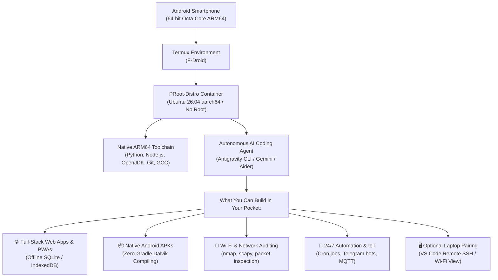

# 📱 The Pocket Developer (PocketDev)

> **Turn any Android smartphone into a complete software engineering, networking, and automation workstation using unprivileged Linux & Autonomous AI Agents.**

[](LICENSE)
[](#)
[-emerald?style=for-the-badge)](#)
[](https://github.com/dahalsandesh/sangalo)

---

### 🚨 The Meta Disclaimer
> **This entire repository—every markdown guide, architecture diagram, bootstrap script, and Git commit—was conceptualized, researched, coded, and published to GitHub 100% from an Android smartphone paired with an autonomous AI coding agent without writing a single line of manual code.**

---

## ⚡ The Manifesto: Pocket Supercomputing

For decades, software development has been gatekept by expensive hardware:
- $2,000+ laptops with 32GB RAM.
- Battery-draining IDEs and bloated Gradle daemons.
- Complex cloud build pipelines with continuous internet dependencies.

Meanwhile, billions of people—especially students, young creators, and developers in emerging regions—carry octa-core 64-bit ARM processors with 8GB to 12GB of RAM in their pockets every day.

**PocketDev is the open-source blueprint to unlock that raw power.**



---

## 🚀 Quickstart: Setup Your Phone in 5 Minutes

You can set up your entire Linux development workstation on Android in one step:

```bash
# 1. Install Termux from F-Droid (NOT Google Play Store!)
# 2. Open Termux and run our 1-tap bootstrap script:
curl -fsSL https://raw.githubusercontent.com/dahalsandesh/pocket-developer/master/setup.sh | bash
```

Or follow the manual step-by-step instructions in [**`docs/01-linux-foundation.md`**](docs/01-linux-foundation.md).

---

## 📚 Masterclass Documentation Modules

| Module | Title | Description |
| :--- | :--- | :--- |
| **01** | [**Linux Foundation**](docs/01-linux-foundation.md) | Termux installation, PRoot Ubuntu 26.04 container, package management, and storage rules. |
| **02** | [**The AI Agent Layer**](docs/02-ai-agent-layer.md) | How autonomous terminal AI agents solve the touchscreen typing bottleneck. |
| **03** | [**Zero-Gradle APK Compilation**](docs/03-native-apk-build.md) | Building native Android APKs in ~10 seconds with `javac`, `dx`, `aapt`, and `apksigner`. |
| **04** | [**Networking, Wi-Fi & Home Lab**](docs/04-networking-homelab.md) | Wi-Fi network auditing, home lab automation, SSH bastions, and headless bots. |
| **05** | [**Hardware Limits & Optimization**](docs/05-hardware-limits.md) | Managing RAM, swap, thermal throttling, and avoiding Android battery killers. |
| **06** | [**Living Proof Showcase**](docs/06-showcase.md) | Deep dive into real-world projects built entirely on mobile (featuring **Sangalo 🇳🇵**). |

---

## 🛠️ Reusable Templates & Examples

This repository includes battle-tested starter projects and templates you can drop directly into your work:

1. **[`examples/hello-pocket/`](examples/hello-pocket/):** Self-contained runnable minimal Android APK project with dark-mode dashboard and native JavaScript bridge. Run `bash build.sh` to compile your first APK in 5 seconds!
2. **[`setup.sh`](setup.sh):** Smart dual-mode bootstrap script (provisions Termux environment on host, or installs complete Android toolchain inside Ubuntu PRoot).
3. **[`templates/build_apk.sh`](templates/build_apk.sh):** Complete 5-step native Android APK compiler pipeline requiring zero Gradle or Android Studio.
4. **[`templates/server.py`](templates/server.py):** Multi-threaded local Python development server configured for mobile LAN testing.

---

## 🏆 Case Study: सँगालो (Sangalo) 🇳🇵

Need proof of what a smartphone paired with an AI agent can build? Look no further than **[सँगालो (Sangalo)](https://github.com/dahalsandesh/sangalo)**:

- **What it is:** A 100% offline, privacy-first everyday digital companion for Nepali households.
- **Key Features Built on Mobile:**
  - 91-year authentic Bikram Sambat (BS 2000–2090) dual calendar verified against national astronomical standards.
  - Native Android status bar pinned date that auto-updates at midnight (`00:00:00`) via `AlarmManager`.
  - Custom medicine routine alarms with audio ringtones, vibration, and snooze adherence tracking.
  - Interactive physics pet companion (Puku) with drag momentum, backflips, and tennis ball fetch mini-game.
  - Offline encrypted document vault and 5x5 strategic Bagh-Chal board game.
- **Build Stats:** Compiled directly on a **Xiaomi Redmi Note 15 Pro 5G** into a **~216 KB signed APK** in 10 seconds!

---

## 👤 Author & Creator

**Sandesh Dahal**  
- 🌐 Website: [dahalsandesh.com.np](https://dahalsandesh.com.np)  
- 🐙 GitHub: [@dahalsandesh](https://github.com/dahalsandesh)  
- 📦 Flagship Project: [Sangalo](https://github.com/dahalsandesh/sangalo)

---

## 🤝 Contributing & Community

We welcome contributions from developers worldwide!
- Read our [**`CONTRIBUTING.md`**](CONTRIBUTING.md) guide for pull request standards.
- Submit a pull request to add your project to [**`docs/06-showcase.md`**](docs/06-showcase.md).
- Help optimize scripts or port tools for other PRoot distributions (Debian, Alpine, Arch).

---

## 📄 License

This project is licensed under the **MIT License** — see the [LICENSE](LICENSE) file for details.

<p align="center">
  <b>The Pocket Developer</b> — Freeing software creation from the desk. Built on mobile for mobile. 📱🚀
</p>
